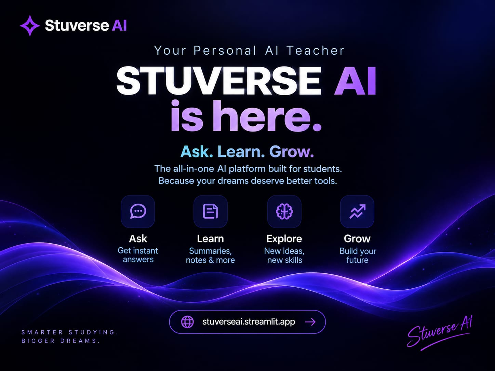
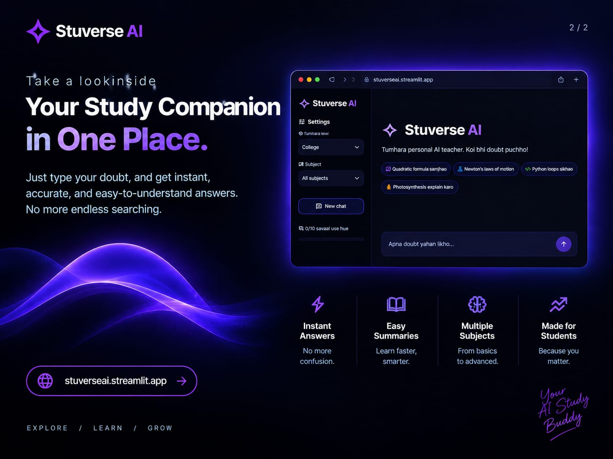

# Stuverse AI — Your Personal AI Teacher 🎓

Stuverse AI is an all-in-one AI study companion built for students. Ask doubts, get step-by-step solutions, upload photos of textbook questions & PDF notes, and master any subject in easy Hinglish!

---

## ✨ What is Stuverse AI?
Stuverse AI is designed to make learning easier, smarter, and more accessible for every student:
- 💬 **Ask**: Get instant, step-by-step answers in simple Hinglish with real-world examples.
- 📖 **Learn**: Summarize complex chapters, formulas, and textbook notes in seconds.
- 📸 **Upload & Solve**: Upload photos of handwritten doubts, textbook questions, or lecture PDFs and get instant explanations.
- 🚀 **Explore & Grow**: Master coding, science, mathematics, and new skills at your own pace.

## 🛠️ Key Features
- **📸 Upload & Solve**: Snap a photo of a textbook question or upload a PDF note, and get clear answers instantly.
- **📜 Multi-Chat History**: Keep track of previous doubts, switch between study threads, and export notes for revision.
- **🎓 Personalized for You**: Select your grade/level (Class 9-10, Class 11-12, College) and subject.
- **💡 Friendly AI Mentor**: Explains concepts with simple real-life analogies in easy-to-understand Hinglish.

## 🌐 Live Application
Try it live at: [stuverseai.streamlit.app](https://stuverseai.streamlit.app/)
